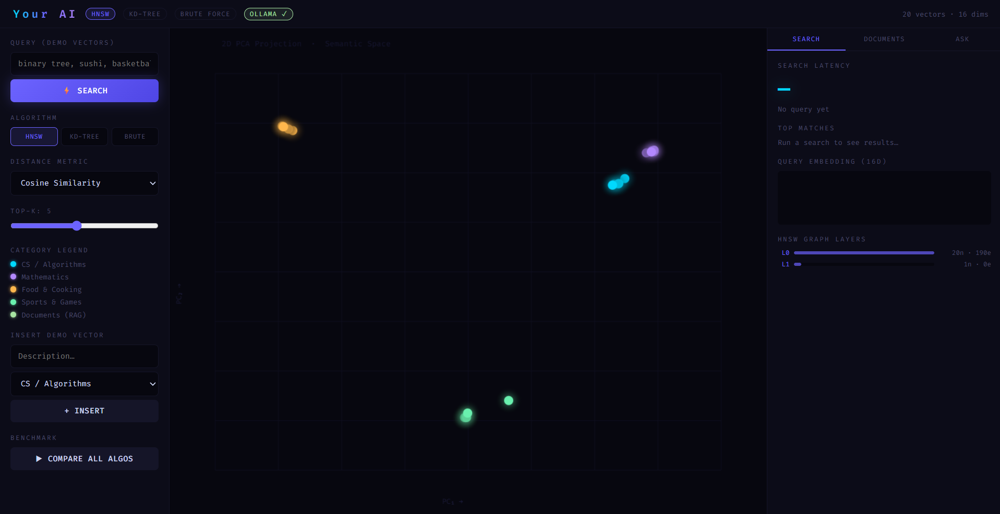
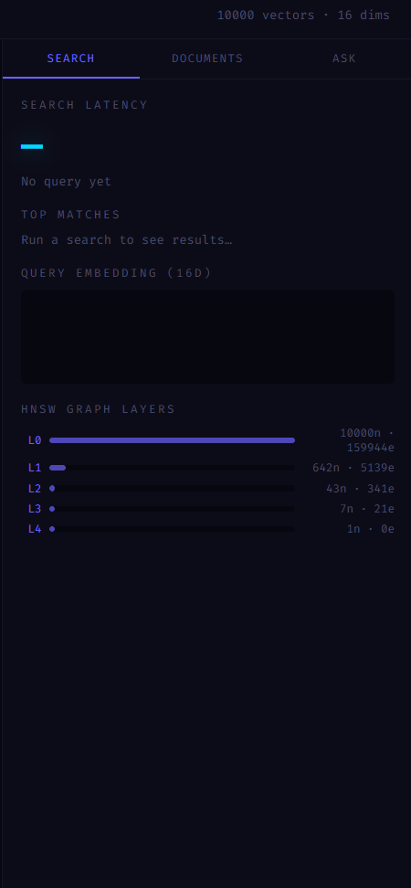
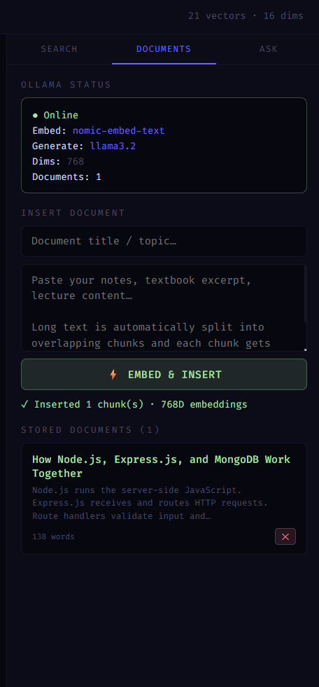
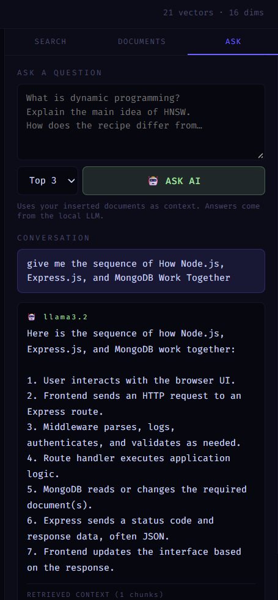

# Your AI — C++ Vector Database & AI-Powered Document Q&A

An AI-powered chatbot and vector database built from scratch in C++. Your AI combines semantic search algorithms with locally running Ollama language models to answer questions using information from your documents.

## Overview

Your AI is an educational AI project that demonstrates how vector databases and Retrieval-Augmented Generation (RAG) systems work internally.

It combines three vector search algorithms, real text embeddings, and a local Large Language Model (LLM) to provide document-based question answering through a web interface.

## System Architecture

See the [System Architecture Diagram](docs/architecture.md) for an overview of the application's components and RAG workflow.

## Features

- **Multiple Search Algorithms:** Implements HNSW, KD-Tree, and Brute Force search.
- **Distance Metrics:** Supports Cosine Similarity, Euclidean Distance, and Manhattan Distance.
- **Semantic Embeddings:** Uses Ollama's `nomic-embed-text` model to convert text into 768-dimensional vectors.
- **Document Processing:** Splits long text into overlapping chunks and generates embeddings.
- **AI-Powered Document Q&A:** Uses Retrieval-Augmented Generation (RAG) to answer questions using relevant document context.
- **Local LLM Integration:** Uses Ollama's `llama3.2` model to generate responses locally.
- **Interactive Web Interface:** Provides search, document management, and AI chat features.
- **Vector Visualization:** Displays a 2D PCA visualization of demo vectors.
- **REST API:** Provides endpoints for vector search, document insertion, deletion, and AI question answering.

## Technology Stack

| Category | Technology |
|---|---|
| Backend | C++ |
| Frontend | HTML, CSS, JavaScript |
| HTTP Server | cpp-httplib |
| Embedding Model | Ollama – nomic-embed-text |
| Language Model | Ollama – llama3.2 |
| Vector Search | HNSW, KD-Tree, Brute Force |
| AI Architecture | Retrieval-Augmented Generation (RAG) |
| Build Standard | C++17 |

## Screenshots

### Main Interface


### Vector Search


### Document Management


### Document Question Answering


## How It Works

Your AI follows a Retrieval-Augmented Generation pipeline:

1. **Document Input:** The user enters document text through the web interface.
2. **Text Embedding:** Ollama converts the text into 768-dimensional vectors.
3. **Vector Indexing:** The C++ backend stores the embeddings in an HNSW index.
4. **Semantic Retrieval:** When a user asks a question, the system searches for the most relevant document chunks.
5. **Context Generation:** The retrieved chunks are passed to the language model.
6. **AI Response:** Ollama's `llama3.2` model generates an answer using the retrieved context.

## Search Algorithms

The project implements three search algorithms:

### 1. HNSW (Hierarchical Navigable Small World)
A graph-based approximate nearest-neighbor search algorithm designed for efficient similarity search in high-dimensional vector spaces.

### 2. KD-Tree
A tree-based spatial indexing structure that partitions multidimensional space to find nearest neighbors.

### 3. Brute Force Search
An exact nearest-neighbor search method that compares the query against every stored vector. It serves as a baseline for comparing search performance.

The application also supports three distance metrics:
- Cosine Similarity
- Euclidean Distance
- Manhattan Distance

## Preliminary Benchmark Results

The following benchmark was performed using the application's
built-in benchmark endpoint.

| Parameter | Value |
|---|---|
| Dataset size | 22 vectors |
| Dimensions | 16 |
| Top-K results | 5 |
| Distance metric | Cosine Similarity |

### Benchmark at 1,000 Vectors

A second benchmark was conducted using 1,000 synthetic 16-dimensional vectors.

**Configuration**
- Dataset size: 1,000 vectors
- Vector dimensions: 16
- Distance metric: Cosine
- Top-k: 5
- Measurements: 25 runs per algorithm

**Average Search Latency**

| Algorithm | Average Latency |
|---|---:|
| Brute Force | 86.00 µs |
| KD-Tree | 3.16 µs |
| HNSW | 43.72 µs |

**Observations**
- KD-Tree achieved the lowest average search latency in this test.
- Brute Force latency increased as the dataset grew from 122 to 1,000 vectors.
- HNSW showed a modest increase in average latency.
- Results are preliminary and based on synthetic data. Performance may vary with dataset size, vector distribution, hardware, and index configuration.

*Benchmark timings are measured in microseconds (µs). These results represent local experiments and are not universal performance guarantees.*

### Benchmark at 10,000 Vectors

A larger-scale benchmark was conducted using 10,000 synthetic 16-dimensional vectors.

**Configuration**
- Dataset size: 10,000 vectors
- Vector dimensions: 16
- Distance metric: Cosine
- Top-k: 5
- Measurements: 25 runs per algorithm

**Average Search Latency**

| Algorithm | Average Latency |
|---|---:|
| Brute Force | 827.92 µs |
| KD-Tree | 4.52 µs |
| HNSW | 44.56 µs |

**Observations**
- KD-Tree achieved the lowest average search latency in this experiment.
- KD-Tree was approximately 183 times faster than Brute Force.
- HNSW also showed substantially lower latency than Brute Force.
- Brute Force latency increased significantly as the dataset grew.

*Results are based on synthetic 16-dimensional vectors and local measurements. Actual performance depends on hardware, data distribution, query configuration, and index implementation.*

### Search Performance

| Algorithm | Search Time |
|---|---:|
| Brute Force | 7 µs |
| KD-Tree | 7 µs |
| HNSW | 43 µs |

**Observation:** In this small dataset test, Brute Force and KD-Tree
recorded lower search times than HNSW.

These are preliminary measurements from a single run. Performance
may vary with dataset size, hardware, and system load. Larger-scale
testing is required for a meaningful comparison.

### Benchmark Command

```powershell
Invoke-RestMethod "http://localhost:8080/benchmark?v=0.9,0.8,0.7,0.6,0.1,0.1,0.1,0.1,0.1,0.1,0.1,0.1,0.1,0.1,0.1,0.1&k=5&metric=cosine"

## Project Structure

```text
Your-AI/
│
├── main.cpp       # C++ backend, vector database, search and RAG
├── httplib.h      # Single-header HTTP server library
├── index.html     # Web interface
├── README.md      # Project documentation
└── .gitignore     # Git ignore rules
```

## Getting Started

### Prerequisites

Install the following:

- Git
- MSYS2 with the UCRT64 GCC compiler
- Ollama
- A Windows computer with at least 8 GB RAM recommended

### 1. Clone the repository

```powershell
git clone https://github.com/prashh29/Your-AI.git
cd Your-AI
```

### 2. Install the required Ollama models

```powershell
ollama pull nomic-embed-text
ollama pull llama3.2
```

Verify the installed models:

```powershell
ollama list
```

### 3. Compile the C++ backend

Using the MSYS2 UCRT64 compiler on Windows:

```powershell
g++ -std=c++17 -O2 main.cpp -o db.exe -lws2_32
```

### 4. Start the application

Make sure Ollama is running, then execute:

```powershell
.\db.exe
```

Open the application in your browser:

```text
http://localhost:8080
```

## Using Your AI

### Vector Search

- Enter a search query.
- Select HNSW, KD-Tree, or Brute Force.
- Select a distance metric.
- View the nearest matching vectors.
- Compare the search algorithms.

### Document Management

- Open the Documents section.
- Enter a document title.
- Paste document text.
- Insert the document to generate embeddings.
- View the stored document chunks.

### Ask AI

- Insert documents first.
- Open the Ask AI section.
- Enter a question about your documents.
- The system retrieves relevant document chunks and generates an answer using Ollama.

## REST API

The backend exposes REST API endpoints on port `8080`.

| Method | Endpoint | Description |
|---|---|---|
| GET | `/search` | Search for nearest vectors |
| POST | `/insert` | Insert a vector |
| DELETE | `/delete/:id` | Delete a vector |
| GET | `/items` | List stored vectors |
| GET | `/benchmark` | Compare search algorithms |
| GET | `/hnsw-info` | View HNSW information |
| GET | `/stats` | View database statistics |
| POST | `/doc/insert` | Insert and embed document text |
| GET | `/doc/list` | List stored documents |
| DELETE | `/doc/delete/:id` | Delete a document chunk |
| POST | `/doc/ask` | Ask questions using RAG |
| GET | `/status` | Check Ollama status |

## Future Improvements

- Persistent storage for documents and embeddings.
- Support for document file uploads.
- Authentication and user management.
- Cloud deployment with a public demo.
- Improved API security and request validation.
- Performance benchmarking with larger datasets.

## Learning Objectives

This project explores:

- Vector database architecture.
- Approximate nearest-neighbor search.
- Multidimensional data structures.
- Semantic search and text embeddings.
- Retrieval-Augmented Generation.
- Integration of local LLMs with C++ applications.
- Backend and frontend communication through REST APIs.

## License

This project is licensed under the MIT License.